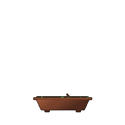

<div align="center">

<a href="https://github.com/guilherme-meloni">
  
</a>

<br/>

<table>
  <tr>
    <td align="center" valign="middle">
      
    </td>
    <td valign="middle">
<pre>
<b>guilherme</b>@<b>arch</b>
────────────────────────────────
OS       Arch Linux
WM       i3
Shell    zsh
Editor   Neovim
Local    Ituiutaba, MG · Brasil
Curso    Eng. da Computação · UEMG
Foco     Full-stack · Sistemas · CLI
Stack    TypeScript · Svelte · Rust
Status   aberto a freelas
</pre>
    </td>
  </tr>
</table>

<a href="mailto:guimeloni8890@gmail.com"></a>
<a href="https://instagram.com/guilhermee_melonii"></a>


</div>

---

## `~/sobre`

Desenvolvedor **full-stack** autodidata, hoje mais perto de **sistemas e ferramentas de linha de comando** do que de interface. Estudo Engenharia da Computação e gosto de entender como as coisas funcionam por baixo dos panos: servidor próprio, Arch Linux, terminal o dia inteiro.

Construo de backends em Node/TypeScript a apps desktop em Rust, sempre com estética funcional (Gruvbox, claro). Aceito projetos como **freelancer**: se você tem uma ideia, me chama no e-mail ou no Instagram.

---

## `~/stack`

<div align="center">

| | |
| :--- | :--- |
| **Linguagens** |  |
| **Front-end** |  |
| **Back-end** |  |
| **Desktop** |  |
| **Infra** |     |
| **Ambiente** |  |

</div>

---

## `~/projetos`

| Projeto | O que é | Stack | Link |
| :--- | :--- | :--- | :--- |
| 📺 **[CanalRetro](https://github.com/guilherme-meloni/canalretro)** | Canal de TV pseudo-live para a sua biblioteca de mídia: grade horária, bumpers e sincronização por timestamp, todo mundo no mesmo segundo. | TypeScript · Fastify · SQLite · FFmpeg | [repo](https://github.com/guilherme-meloni/canalretro) |
| 🌌 **[NeoVerse](https://github.com/guilherme-meloni/NeoVerse)** | Explorador de arquivos 3D onde pastas viram cidades cyberpunk navegáveis em primeira pessoa. *(alpha)* | Tauri · Rust · Three.js | [repo](https://github.com/guilherme-meloni/NeoVerse) |
| 🛒 **[Calculadora de Mercado](https://github.com/guilherme-meloni/calculadora_mercado)** | PWA para controlar o total das compras em tempo real, com várias listas independentes. | Svelte · Vite · Tailwind · Docker | [repo](https://github.com/guilherme-meloni/calculadora_mercado) · [demo](https://calculadora-mercado-one.vercel.app) |
| ⌨️ **[AJUDA CLI](https://github.com/guilherme-meloni/ajuda-cli)** | Cheatsheet interativo de terminal com busca fuzzy, para nunca mais googlar um comando. | Bash · fzf | [repo](https://github.com/guilherme-meloni/ajuda-cli) |
| ☕ **[Café do Cuidado](https://github.com/guilherme-meloni/Caf-do-Cuidado)** | PWA de gestão de medicamentos com metáfora de cafeteria. *(projeto antigo)* | Next.js · React · Tailwind | [repo](https://github.com/guilherme-meloni/Caf-do-Cuidado) · [demo](https://cafe-do-cuidado.pages.dev) |

---

## `~/bonsai`

<div align="center">



<sub>🌳 uma árvore gerada a partir do meu histórico de commits, regenerada todo dia com <a href="https://github.com/egorthinks/git-bonsai">git-bonsai</a></sub>

</div>

---

<div align="center">

```bash
$ echo "feito com ☕, Neovim e Arch Linux"
```

</div>
